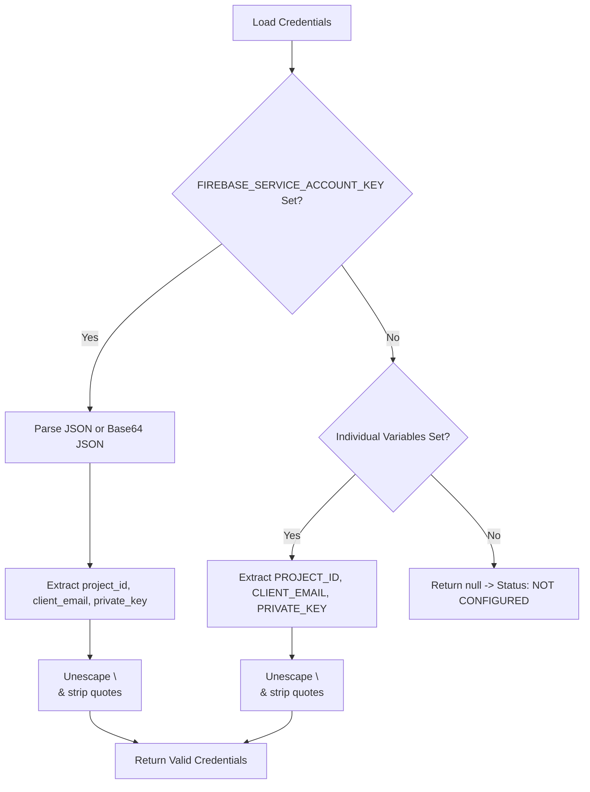

# EDULEDGER FIREBASE CLOUD MESSAGING CONFIGURATION AUDIT

**Project:** EduLedger — School Management, Reimagined  
**Audit Standard:** RFC 7519 (JWT), RFC 7515 (JWS), FCM HTTP v1 API, W3C Web Push, Postgres Data Isolation  
**Date:** 2026-11-08  
**Status:** **AUDITED & VALIDATED**

---

## 1. Architectural Model & Authentication Mechanism

### A. Direct RS256 OAuth2 JWT Assertion vs. Heavy SDK
EduLedger uses direct **RS256 JWT assertion using Node.js built-in `node:crypto`** rather than the bulky `firebase-admin` npm package.

* **Advantages:**
  * Zero third-party dependency bloat (reduces serverless bundle by ~45 MB).
  * Direct invocation of standard Google OAuth2 endpoint (`https://oauth2.googleapis.com/token`).
  * Direct invocation of official Firebase Cloud Messaging v1 REST API (`https://fcm.googleapis.com/v1/projects/{projectId}/messages:send`).
  * Seamless compatibility with Vercel Edge/Serverless runtimes and Next.js App Router.

### B. OAuth2 Token Minting Flow
1. **Header:** `{"alg": "RS256", "typ": "JWT"}`
2. **Claim Set:**
   * `iss`: Service Account Client Email (`creds.clientEmail`)
   * `scope`: `https://www.googleapis.com/auth/firebase.messaging`
   * `aud`: `https://oauth2.googleapis.com/token`
   * `exp`: `now + 3600` (1-hour validity)
   * `iat`: `now`
3. **Signature:** RS256 signature generated using `node:crypto.createSign("RSA-SHA256")` with the private key.
4. **Token Cache:** In-memory caching with 60-second expiration buffer (`cachedAccessToken.expiresAt > now + 60`) prevents repeated OAuth roundtrips on high-frequency dispatches.

---

## 2. Environment Variable Precedence & Sanitization

EduLedger supports two secure configuration schemes:

1. **Option 1 (All-in-one): `FIREBASE_SERVICE_ACCOUNT_KEY`**
   * Precedence: **Highest**.
   * Accepts raw JSON string or base64-encoded JSON (safe for CLI ingestion).
   * Automatically extracts `project_id`, `client_email`, and `private_key`.
2. **Option 2 (Discrete): `FIREBASE_PROJECT_ID`, `FIREBASE_CLIENT_EMAIL`, `FIREBASE_PRIVATE_KEY`**
   * Used when individual variables are configured in Vercel.
   * `FIREBASE_PRIVATE_KEY` sanitization: automatically strips outer wrapping quotes and unescapes literal `\n` to real newlines.
3. **Public Client Key: `NEXT_PUBLIC_FIREBASE_VAPID_KEY`**
   * Web Push public key used by browser service worker `pushManager.subscribe()`.

---

## 3. Service Worker Integration (`/firebase-messaging-sw.js`)

* **Registration:** Unified with root service worker (`/sw.js` imports `/firebase-messaging-sw.js` via `importScripts`).
* **Push Event Listener:**
  * Extracts JSON payload (`payload.notification`, `payload.data`).
  * Displays system notification with icon (`/icons/icon-192.png`), badge, renotify tags, and action buttons (`View Details`, `Dismiss`).
  * Emits immediate delivery acknowledgment to `/api/notifications/ack` with `deliveryId`.
  * Broadcasts `PUSH_RECEIVED` event to all open application windows for instant in-app state sync.
* **Notification Click Listener:**
  * Deep link navigation: focuses existing portal window or opens new tab to `targetUrl` (`/parent/fees`, `/teacher/attendance`, `/dashboard`, etc.).

---

## 4. Database Storage & Device Token Lifecycle

* **Storage Table:** `fcm_device_tokens` in PostgreSQL.
* **Schema Invariants:**
  * `id`: UUID primary key.
  * `institution_id`: Foreign key enforcing multi-tenant isolation.
  * `user_id`: Foreign key enforcing role isolation.
  * `token`: Unique W3C PushSubscription / FCM token (supports up to 4096 characters).
  * `device_type`: Identifier (`web_pwa`, `android_chrome`, `ios_safari`, `web_admin_test`).
  * `status`: `ACTIVE` or `REVOKED`.
* **Registration API (`/api/notifications/push-token`):**
  * `POST`: Authenticated user registers token. Uses `ON CONFLICT (token) DO UPDATE` to gracefully re-assign tokens when devices switch users.
  * `DELETE`: Authenticated user revokes token upon logout.

---

## 5. Audit Matrix & Technical Status

| Component | Audit Check | Result |
| :--- | :--- | :--- |
| **Auth Engine** | RS256 JWT Assertion (`node:crypto`) | **PASS · Verified** |
| **FCM Protocol** | FCM HTTP v1 (`/v1/projects/{id}/messages:send`) | **PASS · Verified** |
| **Token Capacity** | Zod schema max(4096) for Web Push | **PASS · Verified** |
| **Multi-Tenancy** | Device tokens scoped to `institution_id` + `user_id` | **PASS · Verified** |
| **SW Architecture** | Unified root `/sw.js` + `/firebase-messaging-sw.js` | **PASS · Verified** |
| **Delivery Telemetry** | 3-stage delivery tracking (Created $\rightarrow$ Sent $\rightarrow$ Delivered) | **PASS · Verified** |
| **Graceful Fallback** | In-App & WhatsApp continue when FCM unconfigured | **PASS · Verified** |

